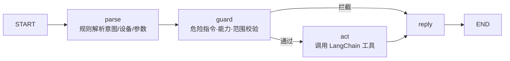

# MiDeviceController

小米智能设备的 Python 控制实验仓库（Yeelight 灯、米家空气净化器、网关、插座）。

最初是一组直连脚本（`ControlXiaomiDevices/testbulb.py` 等，见下方「原有脚本」）。现在补上一层 **MCP Server + LangGraph Agent**，把「怎么控制设备」从脚本里抽出来，变成任何 AI 工作流都能调用的标准能力。

## 目录结构

```
MiDeviceController/
├── ControlXiaomiDevices/
│   ├── device_driver.py      # 设备注册表 + 能力/范围校验 + 真机失败自动降级
│   ├── mcp_server.py         # MCP Server（FastMCP，7 个工具）
│   ├── devices.example.json  # 设备清单示例，复制为 devices.json 使用
│   ├── agent/                # LangGraph 设备 Agent + FastAPI
│   │   ├── graph.py          # 解析 → 安全校验 → 执行 → 回复
│   │   ├── device_tools.py   # LangChain @tool 封装
│   │   └── api.py            # HTTP 入口
│   ├── testbulb.py  testAirpurifier.py  testGateway.py  UDP_Resend.py
│   ├── miio/  yeelight/      # 仓库内置的第三方库（旧版）
│   └── README.md
└── README.md
```

## 快速开始

### 1. 作为 MCP Server 挂到 AI 客户端

```bash
cd ControlXiaomiDevices
pip install -r requirements.txt
python mcp_server.py            # stdio 传输
```

Claude Desktop / Cursor 的配置：

```json
{
  "mcpServers": {
    "device-control": {
      "command": "python",
      "args": ["E:/project/project3/MiDeviceController/ControlXiaomiDevices/mcp_server.py"]
    }
  }
}
```

暴露的 7 个工具：

| 工具 | 说明 |
| --- | --- |
| `list_devices()` | 列出设备（id / 名称 / 类型 / 房间 / 能力） |
| `get_device_status(device_id)` | 查开关、亮度、色温、模式、AQI |
| `set_power(device_id, on)` | 开关 |
| `set_brightness(device_id, brightness)` | 亮度 1–100 |
| `set_color_temp(device_id, kelvin)` | 色温 1700–6500K |
| `set_purifier_mode(device_id, mode)` | auto / silent / favorite / idle |
| `set_purifier_favorite_level(device_id, level)` | 档位 1–14 |

### 2. 本地跑设备 Agent（FastAPI）

```bash
cd ControlXiaomiDevices
python -m agent                 # http://127.0.0.1:8020/docs
```

```bash
curl -s http://127.0.0.1:8020/chat -H 'Content-Type: application/json' \
  -d '{"text":"把客厅灯调暗一点","thread_id":"home-001"}'
```

Agent 的图只有四段，刻意保持简单：



### 3. 直接 HTTP 控制

| 方法 | 路径 |
| --- | --- |
| GET | `/health` |
| GET | `/devices`、`/devices/{id}` |
| POST | `/devices/{id}/power` `{"on": true}` |
| POST | `/chat` `{"text": "...", "thread_id": "..."}` |
| GET | `/graph` |

## 设备配置

复制 `devices.example.json` 为 `devices.json` 并填入局域网 IP 与 token（米家设备 token 可用 `miiocli device --ip <IP> --token <TOKEN> info` 校验）：

```json
{
  "devices": [
    {"id": "light-living", "name": "客厅主灯", "type": "light", "room": "客厅", "ip": "192.168.9.151"},
    {"id": "purifier-living", "name": "客厅空气净化器", "type": "airpurifier", "room": "客厅",
     "ip": "192.168.9.150", "token": "62fc6a0729ef7c1d97662d4ab8d75708"}
  ]
}
```

- 没有 `devices.json` 时自动读取 `devices.example.json`。
- 没填 `ip`、没装 `python-miio` / `yeelight`、或真机调用异常时，一律降级为**内存模拟**，返回 `backend: "simulated"`——没有硬件也能跑通全流程。

## 设计要点

- **能力表优于 if/else**：每种设备类型声明支持的能力（light: power/brightness/color_temp；airpurifier: power/mode/favorite_level/aqi；plug: power），不支持的写操作在进入设备前就被拒绝。
- **参数范围前置校验**：亮度、色温、档位越界直接报错，不发给设备。
- **失败降级**：真机异常只记 warning，不打断对话，返回模拟结果让上层继续。
- **危险操作拦截**：`agent/graph.py` 里的 `guard_node` 拒绝「恢复出厂」「重启网关」「刷机」「改 token」这类指令。
- **一套驱动两种暴露**：`device_driver.py` 同时供给 MCP Server 与本地 Agent，避免两处实现漂移。

## 与客服 Agent 的配合

`Customer_Service_AI` 仓库的 `langgraph_app/` 把本仓库作为 MCP 工具源：用户说「净化器开到静音模式」，客服 Agent 路由到 `device` 意图，经 MCP 调用 `set_purifier_mode`，再把结果组织成自然语言回复。

## 安全提示

- token 等同设备密码，`devices.json` 不要提交到仓库（建议加进 `.gitignore`）。
- 设备只应在可信局域网内暴露，不要做公网端口映射。
- 仓库内置的 `miio/` 是 Python 2 时代的旧拷贝，生产环境请 `pip install python-miio` 使用上游版本。

